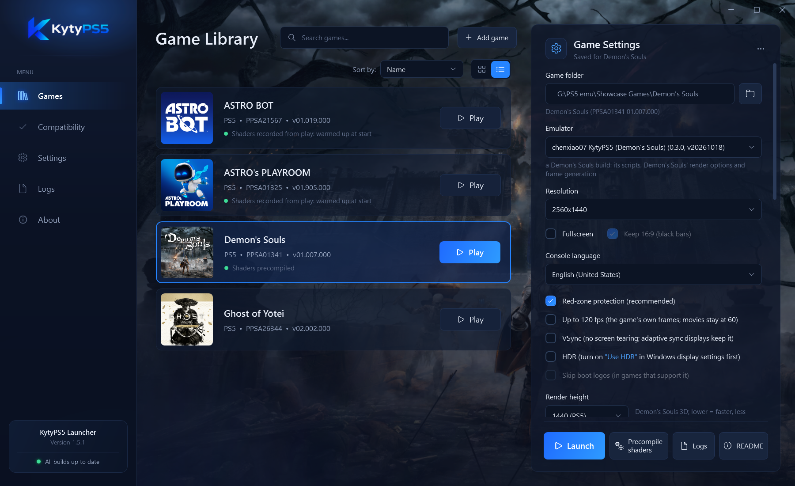
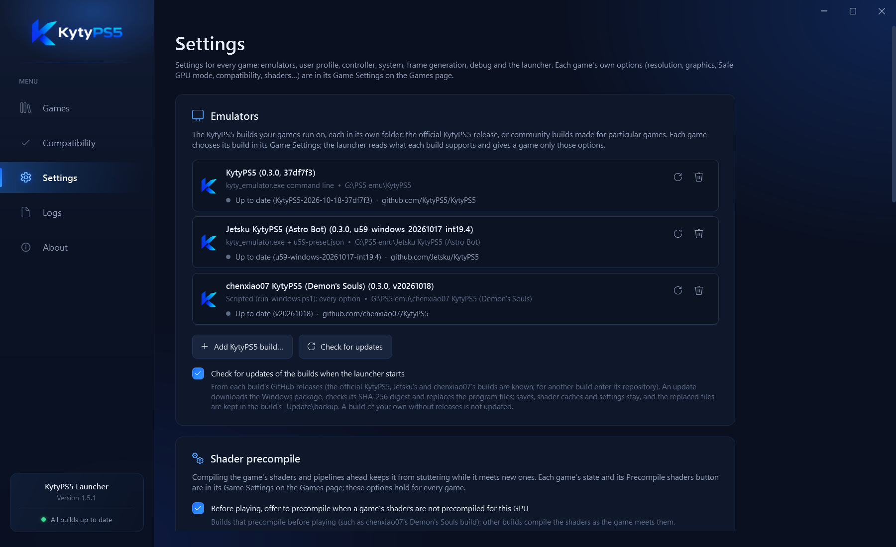
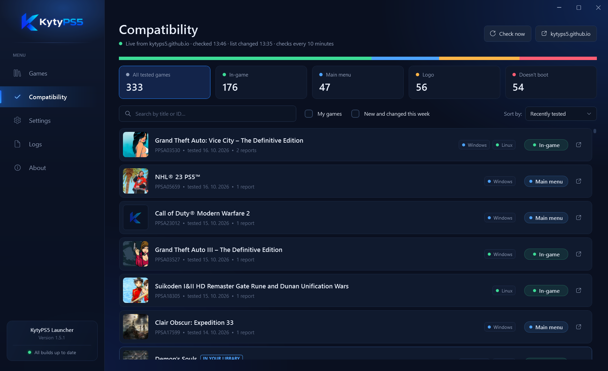

# KytyPS5 Launcher

An unofficial Windows launcher for [KytyPS5](https://github.com/KytyPS5/KytyPS5), the open-source PlayStation 5 emulator
for PC. It keeps your game library, downloads KytyPS5 for you, runs each game on the KytyPS5 build you choose for it and
keeps every build up to date.



> [!IMPORTANT]
> KytyPS5 and this launcher are not affiliated with or endorsed by Sony Interactive Entertainment or PlayStation.
> Neither includes games, firmware or other copyrighted system software. Play only games that you own and have
> obtained legally.

## Features

- **Game library** with each game's cover and artwork, search, list or grid view, and settings saved per game.
- **Works out of the box**: without an emulator it offers to download the latest official KytyPS5 release in one click.
- **Several emulator builds side by side**: the official KytyPS5 and community builds made for particular games. Each
  game picks its build, and the launcher reads what each build supports (its `--help` and switches), so a game is offered
  only the options its build takes; the rest are greyed out.
- **Updates for every build** from its GitHub releases: the Windows package is downloaded, checked against the SHA-256
  digest GitHub lists for it, and installed over the program files. Saves, shader caches and settings stay, and the
  replaced files are backed up.
- **The official launcher's options**: resolution, fullscreen, HDR, VSync, 120 fps, console language, AMD CPU patch,
  rendering compatibility fixes, add-ons (DLC), cheat files, user profile, DualSense lightbar, vibration and speaker,
  graphics card choice, trophy notifications and debug options; plus **Safe GPU mode** for builds that support it.
- **Compatibility list** live from [kytyps5.github.io](https://kytyps5.github.io), with your own games marked and new or
  changed entries highlighted.
- **Shader precompile** for builds that offer it, and the state of each game's shaders at a glance.

| Settings | Compatibility |
| --- | --- |
|  |  |

## Getting started

1. Download `KytyPS5-Launcher-<version>-Windows.zip` from [Releases](../../releases/latest) and unpack it into a folder of
   its own, for example `Documents\KytyPS5 Launcher` (not Program Files: the launcher keeps its library and settings
   beside it). You can also unpack it into a KytyPS5 folder you already have; that build then becomes the launcher's own.
2. Start `KytyPS5.exe`.
3. No emulator yet? Click **Download KytyPS5** on the Games page: the latest official release is downloaded into a
   `KytyPS5` folder beside the launcher. Already have KytyPS5? Click **I have KytyPS5: choose its folder…**.
4. Click **Add game** and choose the game's folder (the one with `eboot.bin` and `sce_sys`) or a `.zar` archive of it.
5. Select the game, check its **Game Settings** on the right and click **Launch**.

Requirements: Windows 10 or 11 (64-bit) with .NET Framework 4.8 (included in current Windows), and a graphics card with
current Vulkan drivers, as KytyPS5 needs.

## How it works

| Page | What it is for |
| --- | --- |
| **Games** | Your library. The panel on the right holds the selected game's own settings: emulator build, resolution and display, stability (Safe GPU mode), compatibility fixes, add-ons and cheats, shaders. |
| **Compatibility** | The KytyPS5 compatibility list, checked every 10 minutes. |
| **Settings** | Settings for every game: emulator builds and their updates, shader precompile, user profile, controller, graphics card and notifications, frame generation, debug, shortcuts. |
| **Logs** | The emulator's logs, for when something goes wrong. |
| **About** | Version, links and licence. |

**Emulator builds.** Add a build in *Settings → Emulators → Add KytyPS5 build…* and choose it in a game's Game Settings.
The official KytyPS5, [Jetsku's](https://github.com/Jetsku/KytyPS5) and [chenxiao07's](https://github.com/chenxiao07/KytyPS5)
builds are recognised for updates; for another build, enter its GitHub repository once beside it.

**Shaders.** A game stutters the first time it meets new shaders. KytyPS5 records them while you play and compiles them
before the next start, so a place stutters only once. Builds with a static precompile offer *Precompile shaders*.

**Your data.** The library and settings are kept beside `KytyPS5.exe` (`launcher-library.json`,
`launcher-settings.json`); saves and shader caches stay in each build's folder (`_SaveData`, `_PipelineCache`). An
unexpected error is written to `launcher-error.log` beside the launcher.

## Building

The launcher is a WPF application (C#, .NET Framework 4.8). With the [.NET SDK](https://dotnet.microsoft.com/download)
installed:

```bat
build.cmd
```

builds `dist\KytyPS5-Launcher\KytyPS5.exe` and the release package `dist\KytyPS5-Launcher-<version>-Windows.zip`.

## Licence

The launcher is free software under the [GNU General Public License version 2](LICENSE). KytyPS5 is made by the
[KytyPS5 developers](https://github.com/KytyPS5/KytyPS5), also under GPL-2.0; the launcher's settings and console
language list follow KytyPS5's official launcher.
